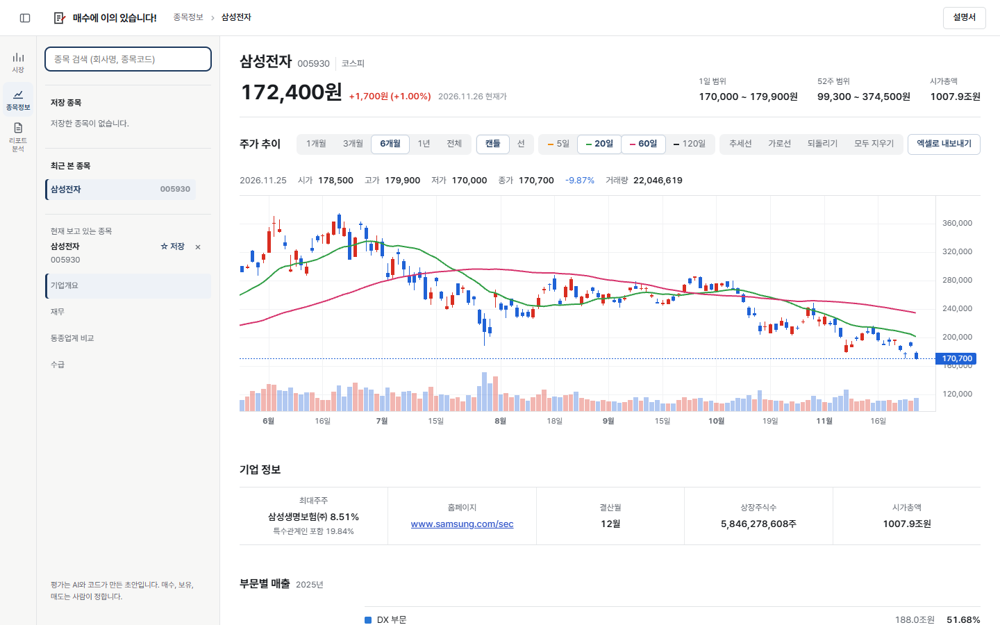
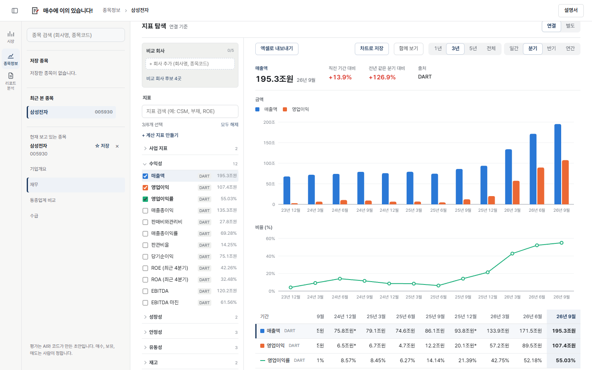
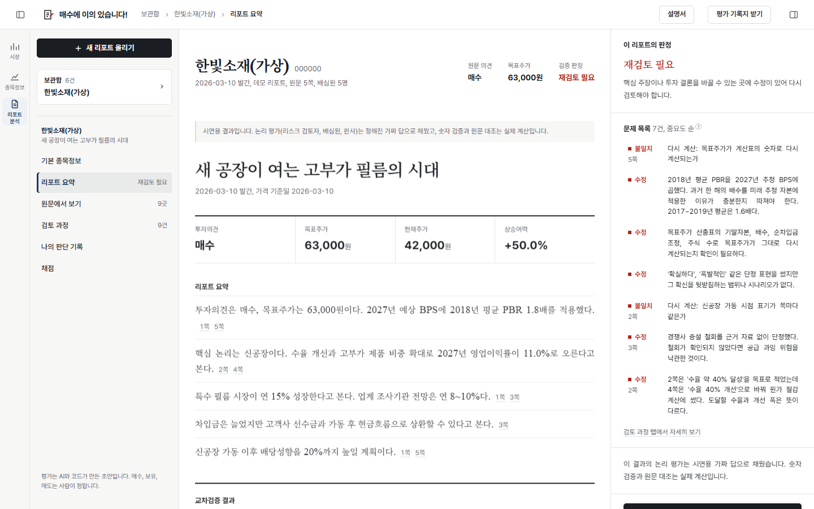
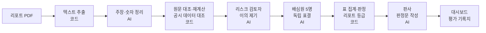

# 매수에 이의 있습니다!

기업 재무 데이터 탐색 및 AI 기반 리포트 검증 플랫폼

기업분석 리포트 작성자와 투자자·검토자를 위한 플랫폼이다. 공시 재무정보를 한 화면에서 조회하고, 필요한 지표를 골라 엑셀로 내보낼 수 있다. 다중 AI 에이전트와 코드 기반 검증으로 리포트의 주장, 수치, 근거를 검토하고, 판정 결과를 원문 근거까지 추적할 수 있게 설계했다. 공시 데이터 탐색부터 작성된 리포트의 주장·수치 검증까지, 분석의 작성과 검토 과정을 하나의 플랫폼에서 지원하는 것이 목표다. 두 기능은 같은 공시·시세 연동 모듈과 캐시를 공유하고, 리포트를 올리면 해당 회사의 재무 대시보드가 함께 생성된다. 결과는 리포트 평가 초안이며 투자 권유가 아니다.







## 문제와 해결

### 1. 재무 정보가 여러 데이터 소스에 흩어져 있다

재무제표, 부문별 매출, 배당, 주가, 동종사 지표를 보려면 여러 사이트를 오가며 반복해서 찾아야 한다.

- 해결: 회사 검색 한 번으로 재무제표, 부문별 매출, 배당, 주가, 수급, 경쟁사 지표를 한 화면에 모았다. 보험·은행 등 금융회사는 업권 특유 지표(K-ICS, CSM 등)를 함께 보여 준다. 토스증권 Open API의 일별 시세와 섹터 정보를 활용해 1975년부터의 수정주가 차트를 보여 주고, 같은 섹터 종목을 경쟁사로 바로 비교할 수 있게 개선했다. 현재가는 10분 단위로 갱신해 화면의 PER·PBR·시가총액이 모두 같은 가격을 쓰게 했다
- 기술: OpenDART 재무제표 API와 XBRL 영업부문 주석, 금융감독원 FISIS, KRX 시세, 토스증권 Open API(조회 전용), Next.js

### 2. 원하는 지표만 골라 가공하는 데 반복 작업이 필요하다

필요한 지표 몇 개를 비교하려 해도 공시를 복사해 표와 차트를 매번 직접 만들어야 한다.

- 해결: 지표를 검색·체크해 최대 6개까지 한 화면에서 비교하고 경쟁사를 최대 5곳까지 겹쳐 본다. 분기·반기·연간 공시 값에 토스증권 일별 종가를 결합해, PER·PBR·배당수익률을 분기 말 값이 아닌 매일 값으로 이어지는 일간 추이로 볼 수 있게 개선했다. 엑셀 내보내기는 기간(1개월~전체, 직접 입력)과 간격(일·주·월)을 골라 필요한 만큼만 받게 했다. 공시 값으로 만든 계산 지표는 저장해 두면 모든 회사에 같은 식으로 적용된다. 엑셀에는 이미지가 아닌 편집 가능한 차트와 원 데이터 표가 들어간다
- 기술: TypeScript 지표 계산, Python openpyxl 네이티브 차트(단위가 다르면 보조 축), 홈페이지 로고에서 회사 상징색 추출

### 3. 편향된 리포트를 읽어도 무엇이 문제인지 알기 어렵다

리포트는 작성자 한 사람의 시각으로 쓰이고 반대 의견이 담기지 않는다. 작성자 역시 발간 전에 자기 논리의 약한 고리를 점검하기 어렵다.

- 해결: 리스크 검토자 에이전트가 원문 인용과 쪽 번호를 붙여 이의를 제기하고, 관점이 다른 배심원 에이전트 5명(회계사, 산업 전문가, 공매도 투자자, 통계학자, 행동경제학자)이 서로의 표를 보지 않고 표결. 초안 PDF를 올리면 수정이 필요한 주장과 근거를 쪽 번호와 함께 반환
- 기술: Claude API 기반 멀티 에이전트(역할별 모델·추론 수준 설정), JSON 스키마 구조화 출력, 역할별 지시문

### 4. 리포트 숫자를 확인하기 어렵고, 일반 AI 요약은 신뢰하기 어렵다

숫자가 공시와 맞는지 대조하는 데 시간이 오래 걸리고, AI 요약은 주장을 되풀이하거나 없는 숫자를 만들 수 있다.

- 해결: 리포트의 계산을 코드로 다시 수행하고 공시·시세·통계와 대조해 일치·불일치·검증 불가로 표시. 원문 인용 확인, 표 집계, 등급 산정도 모두 코드가 담당
- 기술: PyMuPDF 텍스트 추출과 글자 단위 원문 대조, OpenDART·KRX·한국은행 ECOS·통계청 KOSIS API, 규칙 기반 판정(`tribunal/rules.py`), pytest

## 리포트 검증 과정



1. PDF에서 텍스트를 쪽 번호와 함께 추출. 텍스트가 들어 있는 PDF가 대상이며 OCR은 사용하지 않음
2. AI가 핵심 주장, 숫자, 표를 정리하고, 원문에 없는 항목은 코드가 제거
3. 리포트에 적힌 계산식으로 숫자를 재계산하고 공식 데이터와 대조
4. 리스크 검토자가 이의를 제기하고, 배심원이 이의마다 동의·비동의·판단 불가와 중요도를 표시. 배심원은 놓친 문제를 1인당 하나까지 추가 제기 가능
5. 코드가 표를 집계해 판정(수정·확인 필요·유지)과 리포트 등급을 결정하고, 판사는 판정을 바꾸지 않고 판정문만 작성

## 기업 정보 대시보드 구성

- 상장사 재무제표는 DART 재무제표 API, 부문별 매출은 XBRL 영업부문 주석에서 추출한다. 회사별 개별 설정 없이 동작한다
- 같은 지표가 화면마다 다르게 계산되던 문제를 하나의 계산 함수로 묶어, 기업개요·재무 추이·경쟁사 표가 같은 값을 보여 주도록 개선했다
  - EPS: 회사가 공시한 기본주당이익의 최근 4분기 합. DART 분기별 유통주식수로 액면분할 전 분기를 지금 주식 수 기준으로 보정
  - PER·PBR: 그날 종가 ÷ 그날까지 공시된 최근 EPS·BPS. 공시일은 보고서 접수일과 법정 제출 기한 중 빠른 날로 잡아, 나중에 낸 정정 공시가 과거 값을 바꾸지 않게 했다
  - ROE·ROA: 최근 4분기 지배주주 순이익 ÷ 지금과 1년 전 자본의 평균. 지배주주 값이 없으면 다른 값으로 채우지 않고 빈칸
  - BPS: 지배주주 자본 ÷ 그 분기 유통주식수(자기주식 제외)
  - 배당수익률: 그날까지 확정된 최근 연간 주당배당금 ÷ 그날 주가
  - 시가총액: KRX 공식 기준(보통주 종가 × 상장주식수)
- 재료가 하나라도 없으면 빈칸으로 두고, 계산으로 채운 값에는 `*`를 표시한다
- 경쟁사는 비금융회사의 경우 토스증권 섹터 종목을 활용해 찾고, 섹터를 직접 골라 추가할 수 있다. 금융회사는 금감원 FISIS 업권 회사 목록(비상장 포함)을 쓴다. 섹터 등락률 아래에 같은 기간 해당 종목의 등락률을 함께 보여 준다
- 금감원 지표는 DART 숫자와 묶음을 나누고, 출처 옆에 별도·연결 기준을 적어 같은 이름의 지표를 구분할 수 있게 했다
- 받은 자료는 로컬에 캐시한다. 현재가는 10분마다, 새 정기보고서 공시는 그날 처음 열 때 확인해 갱신한다

## 핵심 설계

**수치 계산과 검증은 코드가 담당한다**
LLM은 그럴듯한 숫자를 만들어 낼 수 있다. 그래서 AI의 역할은 리포트에서 숫자를 뽑고 어떤 공시 항목이 같은 뜻인지 고르는 데까지로 제한했다. 계산과 비교는 코드가 맡는다. DART 대조는 두 경로로 나눴다.

- 계정 이름 기준 대조: 매출액·영업이익·순이익 등 주요 계정을 이름, 연도, 연결·별도 기준으로 찾아 리포트 값과 비교. 리포트가 숫자를 잘못 적은 경우 불일치로 탐지
- 값 기준 탐색: 이름만으로 찾기 어려운 주석·본문 표 숫자는 작성일 이전 정기보고서의 숫자를 모두 모은 뒤 값과 기간이 같은 후보를 코드로 찾고, AI가 후보 중 뜻이 맞는 항목의 번호만 선택. 이 경로는 일치 여부만 확인하며 불일치 판정은 계정 이름 기준 대조가 담당

**공식 값만 '일치'로 표시한다**
공시·시세·통계에서 그대로 찾은 값, 그리고 공식 값끼리만 계산한 값(예: 보유 주식 수 × 종가)에만 일치·불일치를 붙인다. 할인율이나 배수 같은 가정을 넣어 계산한 값은 '리포트 추정'으로 남기고 옳고 그름을 판단하지 않는다. 자료가 없거나 기준을 특정할 수 없으면 '검증 불가'로 둔다.

**판정은 결정적 규칙으로 내린다**
같은 표가 나오면 언제나 같은 판정이 나오도록 집계와 등급 산정을 `tribunal/rules.py`에 규칙으로 두었다. 목표주가 같은 결론 주장은 근거가 되는 핵심 주장의 판정을 따른다. 지적 건수로 등급을 나누지 않아, AI가 같은 문제를 여러 건으로 나눠 내도 등급은 바뀌지 않는다. 세부 규칙은 [docs/판정_규칙.md](docs/판정_규칙.md) 참고.

**독립 표결과 근거 추적**
배심원 간 의견 전파를 줄이도록 각 배심원이 다른 배심원의 표를 보지 않고 표결하게 설계했다. 다만 같은 모델 계열이 같은 리포트를 읽기 때문에 판단 오류가 서로 상관될 수 있고, 완전한 독립을 보장하지는 않는다. 모든 이의와 표에 원문 인용, 쪽 번호, 근거 번호를 남겨 사람이 다시 확인할 수 있게 했다. 검증에는 리포트 발간 시점에 공개된 자료만 쓴다.

## 기술 스택

| 영역 | 사용 기술 |
| --- | --- |
| 분석 엔진 | Python, Pydantic, PyMuPDF, PyYAML |
| AI | Anthropic Claude API, Google Gemini(설정으로 전환) |
| 공식 데이터 | OpenDART, KRX Open API, 한국은행 ECOS, 통계청 KOSIS, 금융감독원 FISIS, 공공데이터포털 |
| 시세 | 토스증권 Open API (일별 주가·수급·섹터·현재가, 조회 전용) |
| 대시보드 | Next.js, React, TypeScript, CSS Modules, Lightweight Charts |
| 내보내기 | openpyxl |
| 테스트 | pytest |

## 실행 방법

Python 3.11 이상, Node.js 20.9 이상 필요.

```bash
pip install -r requirements.txt
```

API 호출 없이 실행 가능. `mock/`의 고정 응답을 쓰고, 원문 대조와 숫자 검증은 코드가 실제로 수행한다. `demo/sample_report.pdf`는 실존 기업과 무관한 가상 리포트다.

```bash
python -m tribunal demo/sample_report.pdf --mock --demo --dashboard dashboard
```

실제 AI 분석은 `.env.example`을 `.env`로 복사하고 키를 넣은 뒤 실행한다. 실행 전에 예상 호출 수와 비용을 보여 주고 확인을 받는다.

```bash
python -m tribunal "report.pdf" --dashboard dashboard
```

| 환경변수 | 용도 |
| --- | --- |
| `ANTHROPIC_API_KEY` / `GEMINI_API_KEY` | AI 호출 (`config.yaml`의 `provider`로 선택) |
| `DART_API_KEY`, `KRX_API_KEY`, `ECOS_API_KEY`, `KOSIS_API_KEY` | 공식 데이터 대조 |
| `FISIS_API_KEY`, `DATA_GO_KR_KEY` | 금융회사 지표, 주가 과거 기록 (선택) |
| `TOSS_CLIENT_ID`, `TOSS_CLIENT_SECRET` | 일별 주가·수급·섹터·현재가 (선택, 조회 전용. 없으면 주가는 KRX 자료로 대신) |

대시보드 (`dashboard/`에서 실행):

```bash
cd dashboard
npm install
npm run dev                   # http://localhost:3000
```

테스트 (프로젝트 루트에서 실행):

```bash
pytest
```

## 검증 품질 관리

| 방식 | 내용 |
| --- | --- |
| 오류 주입 테스트 | 공시와 일치가 확인된 숫자를 일부러 바꾼 PDF 사본을 만들어 에이전트가 탐지하는지 채점. 놓친 이유와 오탐을 코드 버전·모델별로 기록 |
| 사람 평가와 비교 | 사람이 직접 분석해 매긴 지적별 타당성·중요도와 AI 결과를 비교. 타당한 지적의 재발견, 부당한 지적의 걸러짐, 등급 일치 여부를 확인 |
| 규칙 단위 개선 | 놓친 유형은 특정 리포트에 맞춘 문구가 아니라 모든 리포트에 적용되는 공통 규칙으로 보완하고, 지시문·모델 변경 때마다 같은 기준으로 재채점 |

AI 판단은 실행마다 달라질 수 있어, 모든 판정에 원문 인용·쪽 번호·근거를 남겨 사람이 재확인할 수 있게 했다. 숫자 대조는 공시·시세·통계에 있는 값을 대상으로 하며, 확인할 수 없는 숫자는 추정하지 않고 '검증 불가'로 남긴다.

## 개선 방향

| 방향 | 내용 |
| --- | --- |
| 검증 성능 확대 | 업종과 작성 기관이 다른 리포트로 오류 탐지율, 잘못된 지적 비율, 판정 일관성, 인용 정확성 측정 범위 확대 |
| 재무 수치 대조 고도화 | 공시 항목의 의미와 회계 기준(연결·별도, 기간)을 고려한 계정 매칭 개선 |
| 사후 예측 성과 검증 | 리포트의 예측을 발간 시점에 기록하고 이후 실제 실적·주가와 비교. 발간 당시의 논리 타당성 평가와는 분리해 운영 |
| 사용자 효과 검증 | 같은 사람이 리포트만 읽은 판단과 검증 결과를 본 뒤의 판단을 비교 |
| 데이터 범위 확대 | 스캔 PDF 지원, DART 주요사항 공시·뉴스 등 문장 근거 자료 연결, 증권사 API로 장중 시세 제공 |

<details>
<summary>폴더 구조</summary>

| 위치 | 내용 |
| --- | --- |
| `tribunal/runner.py` | 전체 분석 순서 실행과 결과 저장 |
| `tribunal/extract.py` | 주장·숫자 추출(AI)과 원문 대조(코드) |
| `tribunal/rules.py` | 표 집계, 이의 판정, 리포트 등급 |
| `tribunal/llm.py` | AI 호출 단일 경로 (역할별 설정, 재시도, 비용 기록) |
| `tribunal/external/` | DART·KRX·ECOS·KOSIS·FISIS·토스증권 연동, 기업 기본정보, 지표 계산, 엑셀 내보내기 |
| `tribunal/quality/` | 오류를 심은 PDF로 숫자 오류 탐지 여부 채점 |
| `prompts/` | 역할별 지시문과 공통 규칙 |
| `dashboard/` | Next.js 대시보드 |

</details>

리포트 원문과 분석 결과는 저장소에 포함하지 않는다.
