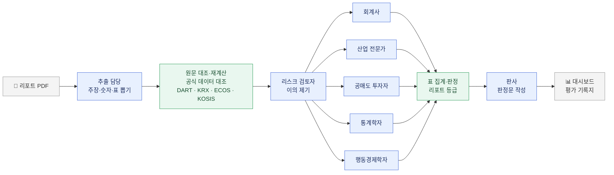
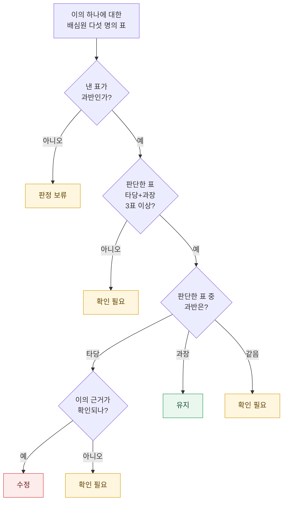
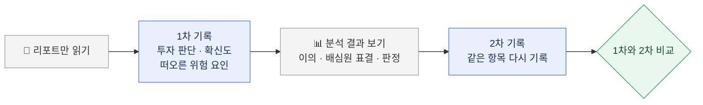

# 매수에 이의 있습니다!

**기업분석 리포트의 투자 논리를 법정처럼 반대신문하는 AI 에이전트**

> **In English** — *Objection to Buy!* is an AI agent that cross-examines equity research reports like a courtroom.
> A risk reviewer raises objections, five independent jurors with different expertise vote on each one,
> and a judge writes the ruling. AI never creates numbers: figures are re-checked by code against the original PDF
> and official data (DART filings, KRX market data, Bank of Korea ECOS, Statistics Korea KOSIS),
> and every verdict is decided by deterministic rules in code, not by the model.
> The tool evaluates a report; it does not rewrite it or give investment advice.

>  화면 캡처는 대시보드 UI 개선 후 추가할 예정입니다.

---

## 왜 만들었나

기업분석 리포트를 읽는 투자자는 이런 문제를 겪습니다.

| 페인포인트 | 내용 |
| --- | --- |
| **반대편 이야기를 들을 곳이 없다** | 리포트는 작성자 한 사람의 시각으로 쓰인다. 투자 논리의 약한 고리를 짚어 주는 반대 의견은 리포트 안에 거의 없다. |
| **숫자를 확인하려면 너무 오래 걸린다** | 리포트의 실적·주가·금리가 공시나 공식 통계와 맞는지, 계산이 맞는지 독자가 하나하나 대조하기는 어렵다. |
| **목표주가가 어디에 기대는지 보이지 않는다** | 결론이 어떤 가정에 크게 기대고, 그 가정의 근거가 충분한지 수십 쪽에서 찾아내기 어렵다. |
| **일반 AI 요약은 믿기 어렵다** | AI에게 요약을 맡기면 리포트 주장을 그대로 되풀이하거나, 그럴듯한 숫자를 지어낸다. |

**그래서 이렇게 풀었습니다.**

| 페인포인트 | 해결 |
| --- | --- |
| 반대 의견이 없다 | **리스크 검토자**가 투자 논리의 약한 고리에 이의를 제기하고, **배심원 다섯 명**이 각자의 전문 분야에서 그 이의가 맞는지 따진다 |
| 숫자 확인이 어렵다 | **코드**가 원문 대조·재계산을 하고, DART·KRX·ECOS·KOSIS의 공식 데이터와 대조한다 |
| 핵심 가정이 안 보인다 | 이의마다 원문 인용과 쪽 번호를 붙이고, 판정 결과를 원문 위에 표시한다 |
| AI를 믿기 어렵다 | **AI는 숫자를 만들지 않고, 판정은 코드가 정한다.** AI는 의견만 내고 결과는 정해진 규칙으로 집계한다 |

---

## 어떻게 작동하나



<sub>🟦 파란색 = AI가 하는 일 (의견) · 🟩 초록색 = 코드가 하는 일 (숫자와 판정)</sub>

| 단계 | 누가 | 하는 일 |
| --- | --- | --- |
| 1. 추출 | AI | PDF에서 핵심 주장, 숫자, 표를 옮겨 적는다. 원문에 글자 그대로 없는 것은 코드가 버린다 |
| 2. 검증 | 코드 | 리포트가 밝힌 식으로 숫자를 다시 계산하고, 공시·시세·통계와 대조한다 |
| 3. 이의 제기 | AI | 리스크 검토자가 원문 전체를 읽고, 원문 인용과 함께 이의를 낸다 |
| 4. 표결 | AI | 배심원 다섯 명이 서로의 표를 보지 않고 이의마다 *타당 / 과장 / 확인 불가* 중 하나를 고른다 |
| 5. 판정 | 코드 | 표를 세어 이의별 판정과 리포트 등급을 정한다 |
| 6. 판정문 | AI | 판사가 코드의 판정을 바꾸지 않고 읽기 쉬운 글로 정리한다 |

---

## 핵심 설계 원칙

| 원칙 | 의미 |
| --- | --- |
| **AI는 숫자를 만들지 않는다** | 계산과 대조는 코드가 한다. AI는 어떤 숫자를 확인해야 하는지만 말한다 |
| **판정은 코드가 한다** | 배심원의 표를 세는 것도, 리포트 등급을 매기는 것도 정해진 규칙(코드)이다. 같은 표가 나오면 언제나 같은 판정이 나온다 |
| **독립 투표** | 배심원은 서로의 표를 보지 못한다. 한 명의 판단이 다른 배심원에게 번지지 않는다 |
| **당시 기준으로 검증** | 리포트가 발행된 시점에 알 수 있었던 정보로만 판단한다. 나중에 결과가 빗나갔다는 이유로 당시 분석을 틀렸다고 하지 않는다 |
| **근거를 남긴다** | 모든 이의와 표에 원문 인용, 쪽 번호, 근거 숫자 번호가 붙는다. 인용은 코드가 원문과 글자 단위로 대조한다 |
| **평가만 한다** | 리포트를 고치지 않고, 매수·매도를 권하지 않는다 |

---

## 다섯 배심원

같은 이의를 다섯 가지 다른 각도에서 봅니다. 업종(보험, 은행, 지주회사, 제조업 등 8개)에 따라 코드가 배심원마다 **업종별 점검 모듈**을 골라 붙입니다.

| 배심원 | 보는 각도 |
| --- | --- |
|  **회계사** | 서로 다른 기준(연결/별도, 기말/평균, 회계 기준)의 숫자를 섞어 쓰지 않았는가 |
|  **산업 전문가** | 수요·경쟁·가격·규제·실행 일정에 관한 사업 가정이 업계 현실과 맞고, 실적 전망으로 이어지는가 |
|  **공매도 투자자** | 가정이 틀리면 손실이 어떤 경로로 번지는가, 시장이 이미 가격에 반영했는가 |
|  **통계학자** | 기간·표본을 유리하게 골랐는가, 추세 연장과 모델이 충분히 튼튼한가 |
|  **행동경제학자** | 주장의 강도가 근거의 강도보다 세지 않은가, 제목·요약이 본문보다 과장되지 않았는가 |

---

## 판정 규칙



- **확인 불가**는 "내 분야로는 판단하기 어렵다"는 표라서, 판정을 막지 않고 판단한 표(타당·과장)만으로 정합니다.
- 한 주장에 이의가 여러 개면 가장 엄한 판정을 따릅니다.

**리포트 등급**

| 등급 | 조건 |
| --- | --- |
| 🔴 **재심리** | 핵심 주장에 *수정* 판정이 있다 |
| 🟡 **조건부 통과** | 그 밖에 *수정 · 확인 필요 · 판정 보류*가 있다 |
| 🟢 **통과** | 문제가 된 이의가 없다 |

---

## 공식 데이터 대조

AI를 쓰지 않고 코드가 공식 데이터와 직접 대조합니다. 결과는 *일치 / 불일치 / 검증 불가* 셋 중 하나이며, 자료가 없거나 기준을 특정할 수 없으면 짐작하지 않고 *검증 불가*로 둡니다.

| 출처 | 대조하는 숫자 |
| --- | --- |
| **OpenDART** (금융감독원 공시) | 매출액, 영업이익, 순이익, 자산·부채·자본, 배당 등 과거 실적 |
| **KRX** (한국거래소) | 현재주가, 시가총액, 상장주식수 |
| **ECOS** (한국은행) | 환율, 기준금리, 국고채·회사채 금리, 소비자물가 |
| **KOSIS** (통계청) | 생산·출하·판매·수출, 물가지수 등 산업 통계 |

모든 결과에 출처, 기준일, 그리고 **리포트 발행 당시 이미 공개된 자료였는지**가 함께 기록됩니다.

---

## 검증 품질 측정

에이전트가 오류를 실제로 얼마나 잡는지 잽니다. 이미 '일치'로 확인된 숫자를 일부러 틀리게 바꾼 PDF 사본을 만들고, 그 오류를 잡아내는지 채점합니다. 탐지율, 놓친 이유, 오탐을 실행마다 코드 버전·모델과 함께 기록합니다.

---

## 효과 검증: 투자자의 판단이 실제로 달라지는가 (진행 예정)

오류를 잘 잡는 것만으로는 부족합니다. **이 도구가 투자자의 판단을 실제로 더 신중하게 만드는지**를 확인하려 합니다.
같은 리포트를 두고 **리포트만 읽었을 때**와 **분석 결과까지 본 뒤**의 판단을 각각 기록해 비교합니다.

- **참여자:** 개발자 본인, 투자 학회원, 일반 투자자
- **방식:** 같은 사람이 분석 결과를 보기 전과 본 뒤의 판단을 비교 (전후 비교)



| 비교할 것 | 보려는 변화 |
| --- | --- |
| 투자 판단 (매수 / 보유 / 매도) | 의견이 바뀌었는가, 바뀌었다면 어떤 이의 때문인가 |
| 확신도 | 근거가 약한 주장에 대한 과신이 줄었는가 |
| 떠올린 위험 요인 | 리포트만 읽을 때 놓친 위험을 새로 인식했는가 |
| 투자 전에 확인할 것 | 무엇을 더 확인해야 하는지 구체적으로 적게 되었는가 |

판단을 바꾸는 것 자체가 목표는 아닙니다. 근거가 탄탄한 리포트라면 분석 결과를 본 뒤에도 판단이 그대로인 것이 정상입니다. **근거가 약한 곳에서만 신중해지는지**를 봅니다.

---

## 기술 스택

| 영역 | 사용 |
| --- | --- |
| 분석 엔진 | Python 3.11+, Pydantic, PyMuPDF |
| AI | Claude API: 리스크 검토자는 Opus 5.5, 나머지는 Sonnet 5.5 (설정으로 Gemini 전환 가능) |
| 공식 데이터 | OpenDART, KRX, ECOS, KOSIS Open API |
| 대시보드 | Next.js, TypeScript |
| 테스트 | pytest (판정 규칙, 숫자 검증, 외부 대조) |

---

<details>
<summary><b>실행 방법</b> (펼치기)</summary>

### 설치

```
pip install -r requirements.txt
```

### 비용 없이 돌려 보기

AI를 부르지 않고 `mock/` 폴더의 가짜 답으로 끝까지 돕니다. 원문 대조와 숫자 검증은 코드가 실제로 합니다.
저장소에 들어 있는 **교육·시연용 가상 리포트**(`demo/sample_report.pdf`, 실존 기업과 무관)로 바로 돌려 볼 수 있습니다. 도구가 잡아낼 만한 약점을 일부러 심어 두었습니다.

```
python -m tribunal demo/sample_report.pdf --mock --demo --dashboard dashboard
```

### 실제 AI로 돌리기 (비용 발생)

`.env.example`을 `.env`로 복사하고 API 키를 넣습니다. 실행 전에 호출 횟수와 예상 비용을 보여 주고 `y`를 눌러야 진행합니다. 실제로 쓴 토큰과 비용은 결과 폴더의 `usage.json`에 역할별로 남습니다.

```
python -m tribunal "리포트.pdf" --dashboard dashboard
```

### 대시보드

```
cd dashboard
npm install
npm run dev
```

http://localhost:3000 에서 PDF를 끌어다 놓고 분석할 수도 있습니다.

### 공식 데이터 대조만 다시 하기

```
python -m tribunal.external library/<리포트 id>/run
```

### 검증 품질 측정

```
python -m tribunal.quality make library/<리포트 id>/run
python -m tribunal.quality run --yes
python -m tribunal.quality report
```

### 테스트

```
pytest
```

</details>

<details>
<summary><b>폴더 구조</b> (펼치기)</summary>

| 위치 | 내용 |
| --- | --- |
| `tribunal/runner.py` | 전체 순서 진행과 결과 저장 |
| `tribunal/extract.py` | PDF에서 주장·숫자 뽑기(AI)와 원문 대조(코드) |
| `tribunal/number_check.py`, `formula_check.py` | 숫자 재계산 |
| `tribunal/external/` | DART · KRX · ECOS · KOSIS 대조 |
| `tribunal/rules.py` | 판정 규칙: 표 집계, 이의 판정, 리포트 등급 |
| `tribunal/modules.py` | 업종 판단과 업종별 점검 모듈 선택 |
| `tribunal/llm.py` | AI 호출 (역할별 모델 선택, 재시도, 비용 기록) |
| `prompts/` | 역할별 작업 지시서와 `modules/` 업종별 점검 모듈 |
| `dashboard/` | Next.js 대시보드 |
| `tests/` | 테스트 |
| `docs/` | [변경 기록 (CHANGELOG)](docs/CHANGELOG.md) |

</details>

---

## 한계와 주의

- 이 도구의 결과는 **평가 초안**이며 투자 권유가 아닙니다.
- AI의 판단은 틀릴 수 있습니다. 그래서 판정마다 근거(원문 인용, 쪽 번호, 숫자 번호)를 남겨 사람이 확인할 수 있게 했습니다.
- 공식 데이터로 확인할 수 없는 숫자는 *검증 불가*로 남깁니다.
- 리포트 원문과 분석 결과는 저장소에 포함하지 않습니다.

## 참고

구조 아이디어는 [court-skill](https://github.com/alexyc9381/court-skill)(MIT), model-court(MIT)를 참고했습니다. 코드는 복사하지 않았습니다.
