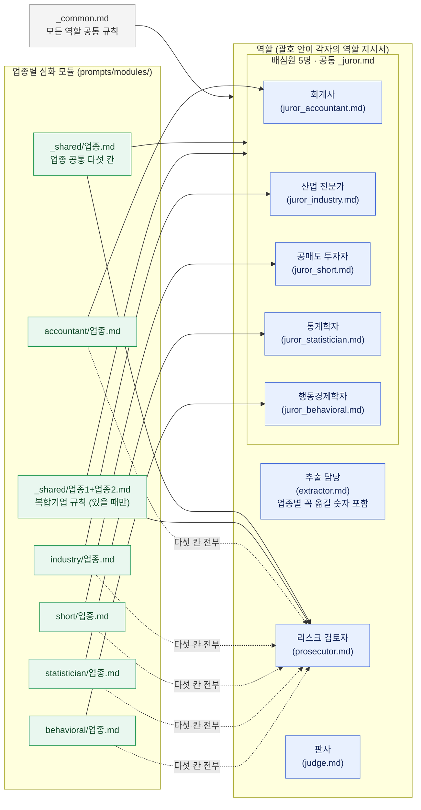

# 지시서 지도

`prompts/` 폴더에 있는 파일이 누구에게, 어떤 순서로 전달되는지 한눈에 보는 안내서다.
(이 파일 자체는 AI에게 전달되지 않는다.)

---

## 용어 사전
문서와 화면, 지시서에서 같은 것은 아래 이름 하나로 부른다.

**역할**
| 용어 | 뜻 |
| --- | --- |
| 추출 담당 | 원문을 읽고 주장, 숫자, 표, 업종을 옮겨 적는 AI |
| 리스크 검토자 | 원문 전체를 읽고 투자 논리의 약한 고리에 이의를 내는 AI |
| 배심원 | 이의마다 표를 내는 AI 다섯 명(회계사, 산업 전문가, 공매도 투자자, 통계학자, 행동경제학자). 서로의 표를 보지 않는다 |
| 판사 | 코드가 정한 판정을 바꾸지 않고 글로 정리하는 AI |
| 코드 | 숫자 계산, 원문 대조, 공식 데이터 대조, 표 세기, 판정을 하는 프로그램. AI가 아니다 |

**자료**
| 용어 | 뜻 |
| --- | --- |
| 원문 | 코드가 PDF에서 쪽 번호와 함께 그대로 꺼낸 글 전체. AI가 고쳐 쓰지 않는다 |
| 추출 결과 | 추출 담당이 원문에서 옮겨 적은 주장, 숫자, 표, 업종 |
| 검토 자료 | 코드 검사를 통과한 추출 결과 + 검토 규칙 + 숫자 검증 결과. 리스크 검토자, 배심원, 판사에게 원문과 함께 넘긴다 |
| 검토 규칙 | 검토 자료 맨 앞의 규칙(자료에 있는 번호만 인용, 작성일 이후의 일은 쓰지 않음 등) |
| 주장 / 핵심 주장 | 리포트가 내세운 주장 3~7개 / 그중 투자의견과 목표주가를 직접 받치는 1~3개 |
| 근거 번호 (지시서에서는 근거 id) | 숫자 R-01, 지표 M-1, 출처 S1 같은 번호. 이의와 표가 무엇을 근거로 했는지 가리킨다 |
| 숫자 검증 결과 | 코드가 숫자를 다시 계산하거나 공시·시세·통계와 대조한 결과: 일치 / 불일치 / 검증 불가 |
| 업종별 심화 모듈 | 업종마다 볼 것을 정리한 글. 업종 공통 파일 + 배심원별 칸 (`prompts/modules/`). **2026-11-21부터 기본으로 끔**(`config.yaml`의 `sector_modules`). 업종과 관계없는 주의할 점만 `_common.md`의 '지적하거나 판단할 때 주의할 점'으로 옮겼다. 아래 모듈 그림은 켰을 때의 모습 |

**절차와 결과**
| 용어 | 뜻 |
| --- | --- |
| 이의 | 리스크 검토자가 낸 지적. 원문 인용과 근거 번호가 붙는다 |
| 추가 이의 | 배심원이 표결하면서 새로 찾은 이의(한 명당 최대 1개) |
| 2차 표결 | 추가 이의를, 그 이의를 낸 배심원을 뺀 나머지가 표결하는 것 |
| 배심원 표 | 배심원 한 명이 이의 하나에 낸 판단: 동의 / 비동의 / 판단 불가 + (동의일 때) 중요도 상·중·하. 자세한 기준은 `docs/판정_규칙.md` |
| 유효표 / 판단한 표 | 기권(호출 실패)을 뺀 표 / 그중 판단을 맡기지 않은 표 |
| 이의 판정 | 표를 모아 코드가 정한 결과: 수정 / 유지(이의 불인정, 경미한 지적) / 확인 필요 / 판정 보류 |
| 리포트 등급 | 이의 판정과 숫자 검증을 모아 코드가 정한 등급: 재검토 필요 / 판정 불완전 / 조건부 통과 / 통과 |
| 투자 전에 직접 확인할 사항 | 사람이 꼭 확인해야 할 것 최대 5개 |
| 평가 기록지 | 결과 전체를 담은 문서 파일 (파일 이름은 `평가기록지.md`) |

**판정 규칙 세 가지**
| 용어 | 정하는 것 | 어디에 |
| --- | --- | --- |
| 배심원 판정 규칙 | 배심원 한 명이 이의 하나에 어떤 표를 내는지 | `_juror.md` (AI) |
| 표결 판정 규칙 | 표를 모아 이의 판정을 정하는 방법 | `tribunal/rules.py` (코드) |
| 리포트 등급 판정 규칙 | 이의 판정(주장별로 가장 엄한 것)과 숫자 검증을 모아 리포트 등급을 정하는 방법 | `tribunal/rules.py` (코드) |

---

## 0. 한눈에: 지시서와 모듈이 누구에게 가나

> 이 그림은 깃허브에서 그림으로 보인다. VS Code에서 그림으로 보려면 확장 프로그램 *Markdown Preview Mermaid Support*를 설치하고 `Ctrl+Shift+V`.



<sub>⬜ 회색 = 모든 역할 공통 · 🟦 파랑 = 역할과 역할 지시서 · 🟩 초록 = 업종별 심화 모듈 · 점선 = 리스크 검토자가 배심원 칸을 빌려 받음</sub>

| 역할 | 공통 규칙 | 역할 지시서 | 업종별 심화 모듈 |
| --- | --- | --- | --- |
| 추출 담당 | `_common.md` | `extractor.md` | 없음 (지시서 안의 '업종별 꼭 옮길 숫자') |
| 리스크 검토자 | `_common.md` | `prosecutor.md` | 업종 공통 + **배심원 다섯 칸 전부** + 복합기업 |
| 배심원 (각자) | `_common.md` + `_juror.md` | `juror_○○.md` | 업종 공통 + **자기 칸** + 복합기업 |
| 판사 | `_common.md` | `judge.md` | 없음 |

자기 이름의 모듈 폴더가 있는 것은 **배심원 다섯 명뿐**이다. 리스크 검토자는 다섯 관점을 모두 훑는 역할이라 배심원 칸을 모두 빌려 받는다. 그래서 `accountant/보험.md`를 고치면 회계사와 리스크 검토자에게 함께 반영된다.

---

## 1. 전체 흐름: 누가 어떤 지시서를 읽나

```
 📄 리포트 PDF
     │
     ▼  [코드] PDF 글자를 쪽 번호와 함께 그대로 꺼냄 (AI 아님, 한 글자도 바꾸지 않음)
     │
     ├───────────────────────────────┐
     │ (원문 글)                      │ (원문 글)
     ▼                                │
 ┌───────────────────────────────┐   │
 │ ① 추출 담당 (Sonnet)          │   │  읽는 지시서: extractor.md + _common.md
 │  추출 결과: 핵심 주장,         │   │  ※ 원문을 옮기거나 다시 쓰지 않는다.
 │  숫자에 번호(R-01…), 표, 업종  │   │    숫자에 번호를 붙여야 코드가 검산할 수 있다.
 └───────────────────────────────┘   │
     │ (추출 결과)                    │
     ▼                                │
  [코드] 추출 결과를 원문과 대조,      │
         번호 붙은 숫자 재계산,        │
         DART·KRX·ECOS·KOSIS 대조,     │
         업종 결정 → 모듈 고르기       │
     │ (검토 자료)                    │
     ▼                                ▼
 ┌──────────────────────────────────────────┐
 │ ② 리스크 검토자 (Opus)                   │  읽는 지시서: prosecutor.md + 모듈(다섯 칸 전부) + _common.md
 │  원문 전체 + 검토 자료를 함께             │
 │  읽고 이의 제기. 인용은 코드가 원문과 대조 │
 └──────────────────────────────────────────┘
     │
     ▼   (배심원도 원문 전체 + 검토 자료 + 이의 목록을 받는다)
 ┌──────────┬──────────┬──────────┬──────────┬──────────┐
 │ ③ 회계사 │ 산업전문가│ 공매도   │ 통계학자 │ 행동경제 │  각자 읽는 지시서:
 │ (Sonnet) │          │ 투자자   │          │ 학자     │  juror_○○.md + 모듈(자기 칸) + _juror.md + _common.md
 └──────────┴──────────┴──────────┴──────────┴──────────┘
     │  서로의 표를 보지 않고 이의마다 동의 / 비동의 / 판단 불가
     ▼
     [코드] 표 세기 → 이의별 판정 → 리포트 등급
     │
 ┌───────────────────────────────┐
 │ ④ 판사 (Sonnet)               │  읽는 지시서: judge.md + _common.md
 │  코드의 판정을 글로 정리       │
 └───────────────────────────────┘
     │
     ▼
 📊 대시보드 / 평가 기록지
```

---

## 2. 파일 목록

| 파일 | 누가 읽나 | 내용 |
| --- | --- | --- |
| `_common.md` | **모두** | 근거와 인용, 숫자는 만들지 않음, 당시 기준 검증, 답 형식 |
| `extractor.md` | 추출 담당 | 무엇을 옮길지(핵심 주장 1~3개, 숫자, 표, 업종) |
| `prosecutor.md` | 리스크 검토자 | 이의를 찾는 순서, 다섯 관점, 이의로 내는 기준 |
| `_juror.md` | 배심원 5명 **공통** | 판단 순서 6단계, 표 기준, 이유 쓰기, 놓친 이의 |
| `juror_accountant.md` | 회계사 | 서로 다른 기준의 숫자를 섞어 썼는가 |
| `juror_industry.md` | 산업 전문가 | 사업 가정이 실적 전망으로 이어지는가 |
| `juror_short.md` | 공매도 투자자 | 가정이 틀리면 손실이 어떻게 번지는가 |
| `juror_statistician.md` | 통계학자 | 기간·표본 선택과 모델이 튼튼한가 |
| `juror_behavioral.md` | 행동경제학자 | 주장의 강도가 근거보다 세지 않은가 |
| `judge.md` | 판사 | 판정을 바꾸지 않고 글로 정리 |
| `modules/` | 리스크 검토자, 배심원 | 업종별 심화 점검 (아래 3장) |

---

## 3. 업종별 심화 모듈 폴더

```
modules/
├─ _shared/                 ← 업종 공통 (모두가 받음)
│   ├─ insurance.md            보험: 1 구조·연결고리 / 2 검증 변수 / 3 쟁점 / 4 위험 / 5 주의
│   ├─ holding.md              지주회사: (같은 다섯 칸)
│   └─ insurance+holding.md    두 업종이 함께 붙을 때만: 복합기업 규칙
│
├─ accountant/              ← 회계사 칸 ("6. 회계사의 ○○ 심화 점검")
├─ industry/                ← 산업 전문가 칸
├─ short/                   ← 공매도 투자자 칸
├─ statistician/            ← 통계학자 칸
└─ behavioral/              ← 행동경제학자 칸
     각 폴더 안: insurance, holding, bank, securities, manufacturing,
                 construction, consumer, software (8개 업종)
```

- 지금 **보험과 지주회사**만 공통 파일과 깊은 칸이 있다(2026-11-18 강화).
- 나머지 6개 업종은 공통 파일이 없고, 배심원 칸도 몇 줄짜리 예전 내용이다. 그 업종 리포트를 분석할 때 강화한다.

### 업종은 누가 정하나
코드(`tribunal/modules.py`)가 정한다. 사람이 고르지 않는다.
1. 추출 담당이 적은 업종 (예: "보험, 지주회사", 최대 2개)
2. 없으면 회사 이름의 낱말 (예: "○○생명" → 보험, "○○홀딩스" → 지주회사)
3. 평가 방식이 SOTP·NAV면 지주회사를 더함
4. 그래도 못 정하면 모든 업종별 심화 모듈을 붙임

---

## 4. 실제로 전달되는 글의 순서

예시: **보험 + 지주회사** 리포트

**회계사가 받는 글**
```
1. _common.md                        모두 공통 규칙
2. (리포트 원문 전체)
3. juror_accountant.md               회계사 지시서
4. # 업종별 심화 모듈
   ├─ _shared/insurance.md           보험 공통 다섯 칸
   ├─ accountant/insurance.md        회계사의 보험 칸
   ├─ _shared/holding.md             지주회사 공통 다섯 칸
   ├─ accountant/holding.md          회계사의 지주회사 칸
   └─ _shared/insurance+holding.md   복합기업 규칙
5. _juror.md                         배심원 공통 규칙
6. (검토 자료: 숫자, 코드 검증 결과, 이의 목록)
```
다른 배심원도 같고, 3번과 4번의 '자기 칸'만 다르다.

**리스크 검토자가 받는 글**
```
1. _common.md
2. (리포트 원문 전체)
3. prosecutor.md
4. # 업종별 심화 모듈
   ├─ _shared/insurance.md
   ├─ 회계사·산업·공매도·통계·행동 의 보험 칸 (다섯 개 전부)
   ├─ _shared/holding.md
   ├─ 다섯 명의 지주회사 칸 (전부)
   └─ _shared/insurance+holding.md
5. (검토 자료: 숫자, 코드 검증 결과)
```
배심원 공통 규칙(`_juror.md`)은 받지 않는다.

**추출 담당, 판사**는 모듈을 받지 않는다: `역할 지시서 + _common.md + 검토 자료`.

---

## 5. 무엇을 바꾸려면 어디를 고치나

| 바꾸고 싶은 것 | 고칠 파일 | 영향받는 역할 |
| --- | --- | --- |
| 모든 AI의 기본 원칙 (인용, 숫자, 시점) | `_common.md` | 모두 |
| 배심원의 표 기준, 이유 쓰는 법 | `_juror.md` | 배심원 5명 |
| 특정 배심원의 관점 | `juror_○○.md` | 그 배심원 |
| 보험 업종에서 볼 것 (모두 공통) | `modules/_shared/insurance.md` | 리스크 검토자 + 배심원 5명 |
| 보험 업종에서 회계사만 볼 것 | `modules/accountant/insurance.md` | 회계사 + 리스크 검토자 |
| 이의를 찾는 방식 | `prosecutor.md` | 리스크 검토자 |
| 무엇을 옮겨 적을지 | `extractor.md` | 추출 담당 |
| 판정문 쓰는 법 | `judge.md` | 판사 |
| 판정 규칙 (표 세기, 등급) | 지시서가 아니라 코드 `tribunal/rules.py` | — |

## 6. 새 업종을 강화할 때

- **꼭 할 것:** `modules/_shared/<업종>.md` 하나 쓰기 (다섯 칸)
- **원하면:** 배심원 폴더마다 `<업종>.md`에 '6. ○○의 심화 점검' 칸 쓰기
- **원하면:** 자주 함께 나오는 조합이면 `_shared/<업종1>+<업종2>.md`
- 역할 지시서와 공통 규칙은 고치지 않는다.
